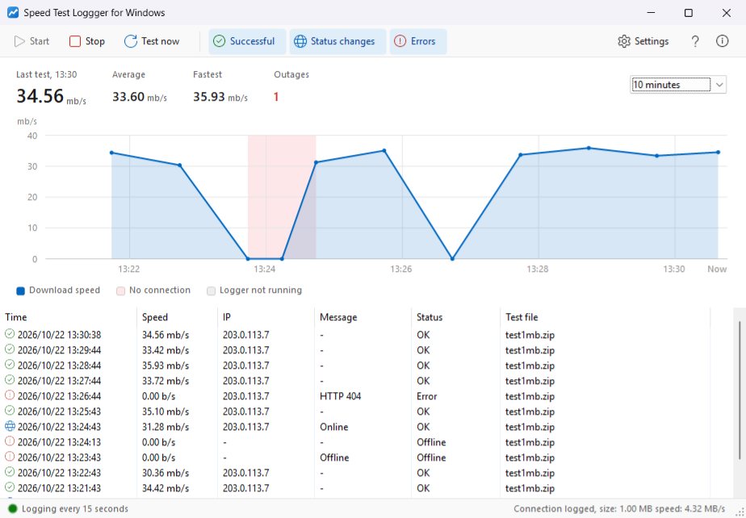
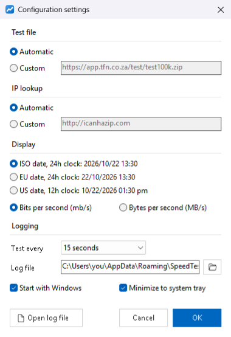

# Speed Test Loggger

A Windows app that tests your download speed on a schedule, graphs it over time and logs internet outages, so you can see how reliable your connection really is.

## Install

Go to **https://fifothehein.github.io/Speed-Test-Loggger/** and click **Download installer**. You can also download `Logger_Setup.exe` from the [latest release](https://github.com/FifoTheHein/Speed-Test-Loggger/releases/latest).

- The installer adds .NET Framework 4.8 if it's missing.
- The app checks for updates each time it starts and installs new versions automatically.
- The certificate is self-signed, so Windows shows the publisher as unknown.

**Upgrading from 1.3 or earlier:** uninstall "Speed Test Loggger" from *Settings → Apps* first, then install from the link above. Those versions were installed with updates turned off, so they can't update themselves. Your log is kept: it's stored separately in `%AppData%\SpeedTest`.

## Using it

- **Start** runs a speed test on the interval set in *Settings*, from every 15 seconds to every hour. The status bar shows whether it's logging.
- Each test records the time, your public IP, the download speed and whether you were online.
- The graph shows speed over the last 10 minutes up to 24 hours, with the last, average and fastest speeds and the number of outages above it. Red bands mark times with no connection, and grey bands times the logger wasn't running.
- The toolbar's **Successful**, **Status changes** and **Errors** buttons choose which results the list shows.
- The log is saved as a CSV file. Use *Settings → Open log file* to open it.

## Building

Open `SpeedTest.sln` in Visual Studio 2022 or later with the .NET desktop development workload, then build. The project targets .NET Framework 4.8.

Release builds sign the ClickOnce manifests with the certificate whose thumbprint is in `SpeedTest/SpeedTest.csproj`. The certificate's `.pfx` file isn't in the repo. Without it, build with `/p:SignManifests=false`.

## Releasing

1. Bump the version in a PR: `ApplicationVersion` in `SpeedTest/SpeedTest.csproj`, `AssemblyVersion` and `AssemblyFileVersion` in `SpeedTest/Properties/AssemblyInfo.cs`, and the About box text in `SpeedTest/FormMain.cs`.
2. Once it's merged, publish a GitHub release tagged with the same version, for example `v1.4.0`.
3. The **Publish release** workflow builds and signs the app and deploys it to GitHub Pages. It also attaches the installer, `Logger_Setup.exe`, to the release. Installed copies pick up the update the next time they start.

The workflow signs with the certificate in the `SIGNING_PFX_BASE64` and `SIGNING_PFX_PASSWORD` repository secrets. It fails if the tag doesn't match `ApplicationVersion`.

## License

AGPL v3. See [LICENSE](LICENSE). Based on [Speed Test Loggger](https://github.com/A9T9/Speed-Test-Loggger) by a9t9, Copyright © 2015 a9t9.
